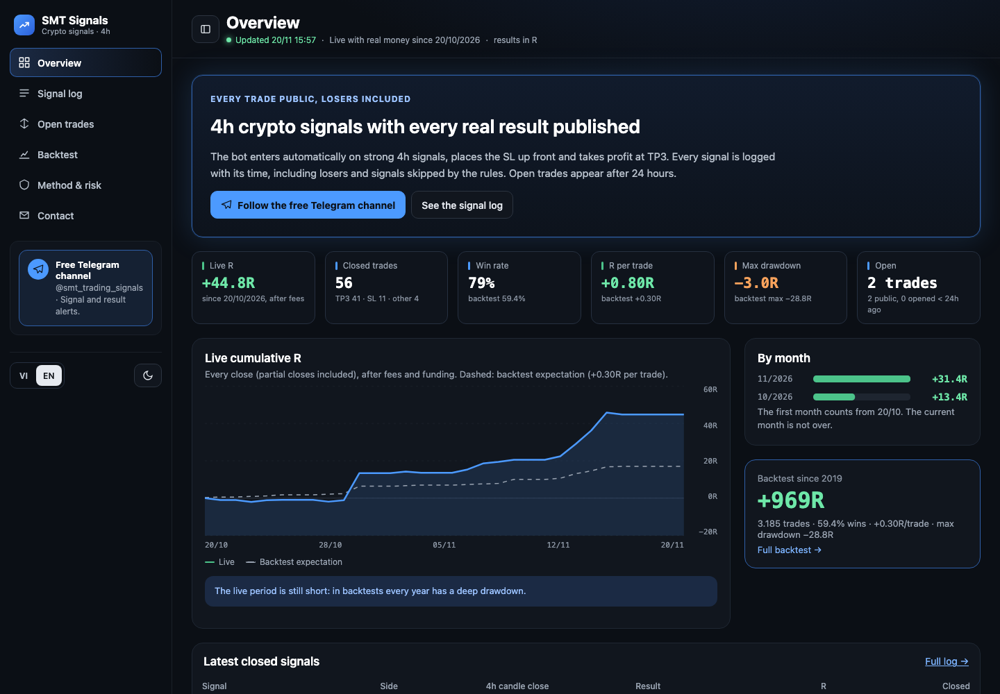
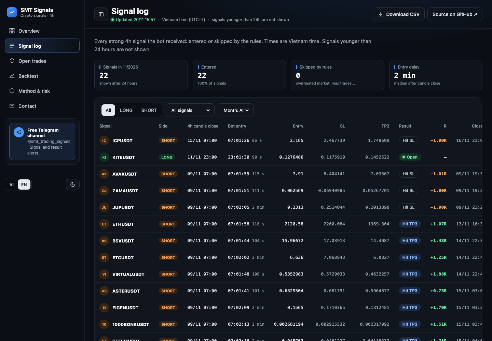
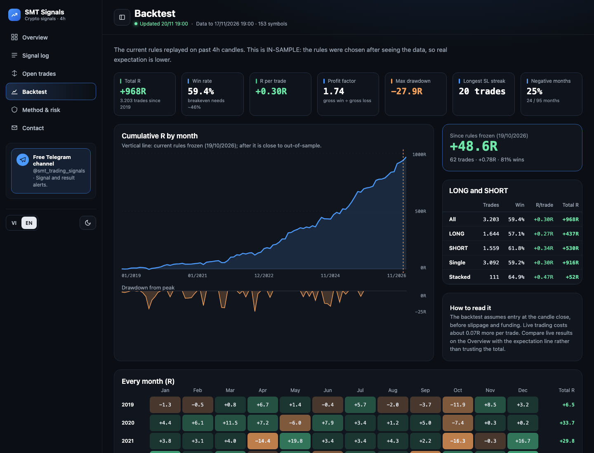
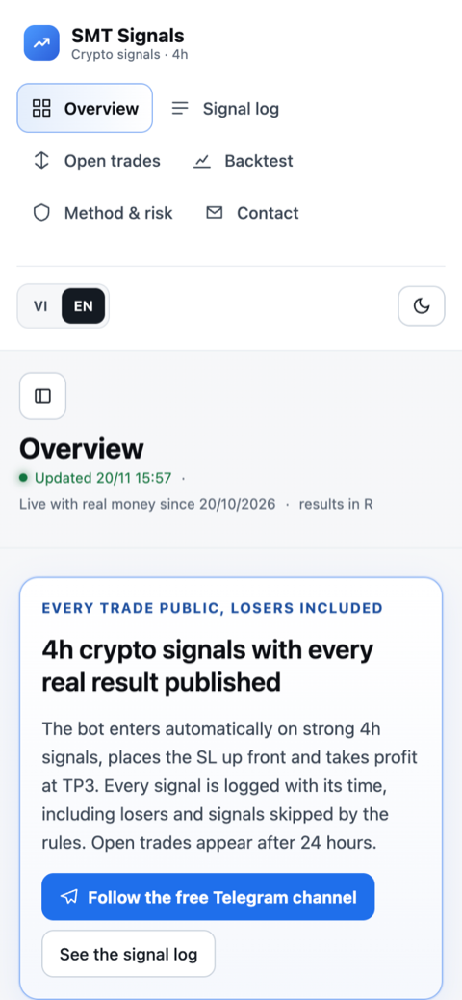

# SMT Signals

Crypto futures signals on the 4-hour chart, traded automatically with real money. **Every result is published, losers included.**

**[🌐 Open the website](https://smt-signals.github.io/)** · **[📣 Free Telegram channel](https://t.me/smt_trading_signals)** · **[📄 Signal log (CSV)](data/signals.csv)**

[](https://smt-signals.github.io/)

> **Not investment advice.** Past results and backtests do not guarantee future results. Leveraged crypto futures can lose all of your capital.

## Contents

- [Pages](#pages)
- [Screenshots](#screenshots)
- [What this repository is](#what-this-repository-is)
- [How to verify the numbers](#how-to-verify-the-numbers)
- [What is published and what is not](#what-is-published-and-what-is-not)
- [Data files](#data-files)
- [Results in R](#results-in-r)
- [Backtest](#backtest)
- [Beware of impersonators](#beware-of-impersonators)

## Pages

| Page | Link | What you find there |
|---|---|---|
| Overview | [/](https://smt-signals.github.io/) | Live R since launch, win rate, drawdown, R by month, latest closed signals |
| Signal log | [/log/](https://smt-signals.github.io/log/) | Every signal with candle time, entry time and delay, entry, SL, TP3, result; filters and CSV |
| Open trades | [/open/](https://smt-signals.github.io/open/) | Trades open for 24 hours or more, distance to TP3, floating R |
| Monthly reports | [/report/](https://smt-signals.github.io/report/) | Each calendar month: R, trades, win rate, drawdown vs backtest expectation, with an image and text to share |
| Backtest | [/backtest/](https://smt-signals.github.io/backtest/) | Cumulative R by month since 2019, drawdowns, every month and year, LONG vs SHORT |
| Method & risk | [/method/](https://smt-signals.github.io/method/) | How the bot trades, what an R is, risks to know, FAQ |
| Contact | [/contact/](https://smt-signals.github.io/contact/) | Email, Telegram, how to spot impersonators |

Light and dark themes, phone-friendly. Contact: smtsignals.contact@gmail.com · Telegram [@smt_bot_signals](https://t.me/smt_bot_signals).

## Screenshots

Taken on 20 Nov 2026. The website always shows the latest numbers.

**Signal log**: every signal, including losers and the time the bot entered.

[](https://smt-signals.github.io/log/)

**Backtest**: the current rules replayed since 2019; the dashed line marks the date the rules were frozen.

[](https://smt-signals.github.io/backtest/)

**On a phone** (light theme):

<a href="https://smt-signals.github.io/"></a>

## What this repository is

This repository holds the **generated** website and its data, nothing else. The trading bot's code is private.

The bot runs on a server. About 30 minutes after each 4-hour candle closes, it rebuilds the site from its own trade records and pushes **one commit** here. The commit message is `update <time> (UTC+7): <signals> signals, <closed> closed, <total>R`.

Nobody edits these files by hand. If you see a change that did not come from an `update` commit, please tell us.

## How to verify the numbers

The commit history is the proof: a signal that appears in a commit existed at that time.

- **When a signal was first published:** open [`data/signals.csv`](data/signals.csv) → *History*, or run:
  ```bash
  git log -S "KITEUSDT,LONG,2026-11-11T16:00:00Z" --reverse --format="%h %ad" -- data/signals.csv
  ```
- **Whether a past result was changed:** `git log -p -- data/signals.csv`. Normally a row is added, then filled in once when the trade closes (`open` → `tp` / `sl` / `manual`). Any later correction would show up in this history.
- **Real-time timestamps:** entries and results are posted on the Telegram channel the moment they happen. Telegram shows the time of every post, and edits are marked.

## What is published and what is not

| Published | Not published |
|---|---|
| Every strong 4h signal the bot received, once its candle closed **24 hours** ago | Money amounts, balances, position sizes, leverage |
| Entry time, entry price, SL, TP3, result in R | Internal and exchange order IDs, logs |
| Signals the bot **skipped by its own rules** (overheated market, maximum open trades, opposite of an open trade, daily loss stop) | Signals the bot **missed for technical reasons** (exchange rejection, insufficient margin, bot not running) |
| Open trades, but only after they have been open for **24 hours** | Test trades and demo-account trades |

Why the 24-hour delay on the website? Entering hours after the bot usually gets a much worse price, so the site is not meant for copying entries. Live alerts go to the Telegram channel.

## Data files

### `data/signals.csv`

One row per signal, oldest first. Times are UTC, ISO 8601.

| Column | Meaning |
|---|---|
| `symbol` | Binance USDⓈ-M perpetual, e.g. `KITEUSDT` |
| `side` | `LONG` or `SHORT` |
| `signal_candle_close_utc` | Close time of the 4h signal candle |
| `status` | `tp` hit TP3 · `sl` hit SL · `manual` closed another way · `open` still open · `rule` skipped by a rule |
| `entered_at_utc` | When the bot's market order filled (empty for `rule`) |
| `late_entry` | `1` if entered more than 30 minutes after the candle close (catch-up entry) |
| `entry`, `sl`, `tp3` | Entry price (signal close price for `rule`), stop loss, take profit 3 |
| `r` | Result of the whole trade in R, after fees and funding (empty while open) |
| `closed_at_utc` | When the trade fully closed |

### `data/monthly/YYYY-MM.txt`

The share text of each finished month, as posted on the Telegram channel. The month's image is in `assets/monthly/YYYY-MM.png`.

### `data/summary.json`

Totals at the time of the update:
- `live`: closed trades, TP3 / SL / other counts, win rate (TP3 ÷ (TP3 + SL)), total R, R per trade, max drawdown in R, open trades shown / not yet shown.
- `backtest`: trades, win rate, total R, R per trade, max drawdown, data end, and the date the current rules were frozen (`rules_since`).

## Results in R

Every trade risks a fixed amount if the SL is hit; that amount is **1R**. Results are in R so they do not depend on account size: with 1R = 10 USDT, +2.5R means +25 USDT.

- An SL hit is about **−1R**, fees included.
- `Total R` on the site adds every close, including partial closes of trades that are still open.

## Backtest

The [Backtest page](https://smt-signals.github.io/backtest/) replays the current rules on past 4h candles from 2019. It is **in-sample**: the rules were chosen after seeing that data, and it assumes entry at the candle close before slippage and funding. Expect live results to be lower. The vertical line on the chart marks the date the rules were frozen; trades after it are close to out-of-sample.

## Beware of impersonators

SMT Signals will never:
- message you first to offer investments or ask for money;
- hold funds or manage money for anyone;
- ask for passwords, 2FA codes, or API keys with withdrawal permission.

The only official channels are **smtsignals.contact@gmail.com**, **[@smt_bot_signals](https://t.me/smt_bot_signals)** and **[@smt_trading_signals](https://t.me/smt_trading_signals)**.
